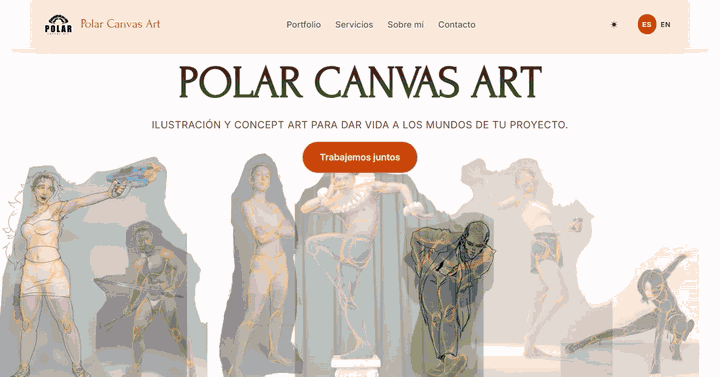
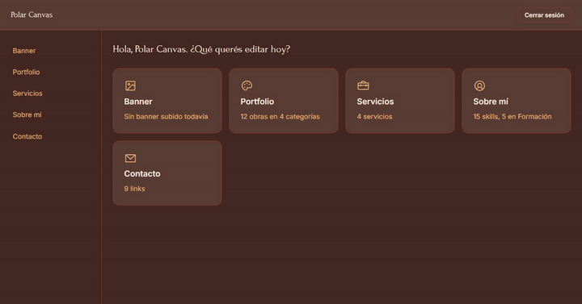
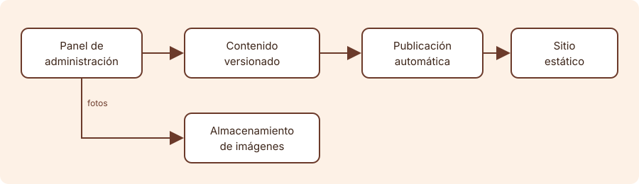

# Polar Canvas

Sitio de portfolio bilingüe (español e inglés) para Polar Canvas, la marca de una ilustradora y diseñadora, con un panel de administración para que la clienta actualice el contenido sin tocar código. Es un trabajo freelance que diseñé y desarrollé sola durante julio y agosto de 2026 y que ya entregué. El código es privado porque pertenece a una clienta.

Sitio en producción: [web-polar-canvas.vercel.app](https://web-polar-canvas.vercel.app)

## Problema que resuelve

La clienta necesitaba mostrar su trabajo y, sobre todo, poder cambiarlo ella: subir obras nuevas, editar textos en dos idiomas, cambiar fotos y redes. No programa y no iba a depender de mí para cada cambio.

El desafío técnico era que el sitio público siguiera siendo estático (rápido, indexable, sin servidor propio) y que además se pudiera editar desde un panel, con una sola usuaria y sin costos fijos.

## Demo

- Sitio público: [web-polar-canvas.vercel.app](https://web-polar-canvas.vercel.app)
- Recorrido por el sitio:

  

- Panel de administración, grabado en una instancia de prueba:

  

El panel real es privado, así que lo que se ve acá es una instancia de prueba, sin guardar cambios reales.
Hoy el sitio muestra contenido de muestra: la clienta todavía no cargó sus imágenes y descripciones definitivas.

## Tecnologías

- Astro y TypeScript para el sitio público, generado de forma estática.
- React para las partes interactivas y el panel.
- Zod para validar los datos.
- Cloudflare R2 para las imágenes.
- Vercel para el hosting.
- Google OAuth 2.0 para el acceso al panel.
- Playwright para pruebas end-to-end automatizadas del sitio y del panel.

## Cómo funciona

El sitio público se genera de antemano a partir de archivos de contenido versionados, por eso carga rápido y se indexa bien. El panel es parte del mismo proyecto, con acceso restringido mediante Google. Cuando la clienta guarda un cambio, se valida y se publica de forma automática, y el sitio se actualiza en un par de minutos. Las fotos se recortan en el navegador a la proporción de cada categoría antes de subirse.

Las decisiones que tomé y por qué:

- **Contenido versionado en vez de base de datos.** Hay una sola persona editando, poco tráfico y la idea era no tener costos fijos. Además cada cambio queda registrado y se puede deshacer.
- **Recorte de fotos antes de subirlas.** Cada categoría tiene una proporción fija, así el sitio no necesita lógica extra para mostrar las imágenes y no hay procesamiento en el servidor.
- **Acceso por Google en vez de usuario y contraseña.** Es una sola usuaria, así que no hay contraseñas que gestionar ni rotar.
- **Alcance acotado.** Dejé afuera funciones que no le servían a una usuaria no técnica (historial, previsualizaciones) y puse el esfuerzo en lo que sí: mensajes de error claros y confirmación antes de borrar.
- **Manual de uso entregado.** Junto con el panel entregué un manual para la clienta, escrito sin términos técnicos. Explica cómo entrar, el selector de idioma, qué pasa al eliminar algo, cómo subir y recortar fotos y cómo leer los avisos y errores, y tiene una sección por cada pantalla del panel.

## Cómo correrlo

No se corre: se ve desde el link. El sitio está en [web-polar-canvas.vercel.app](https://web-polar-canvas.vercel.app) y el panel en los GIF de la sección Demo. El código es privado.

## Qué aprendí y qué mejoraría

**Qué aprendí**

- A trabajar con Claude Code de forma útil. Armé un `CLAUDE.md` que define el alcance del sistema: stack, decisiones ya tomadas, qué queda afuera y cómo se trabaja. Con eso el asistente deja de repreguntar o de rehacer lo descartado, y no tengo que repetir "acordate de..." o "te dije que esto no va".
- A integrar Google OAuth 2.0 con el flujo Authorization Code y a sostener la sesión de forma segura.
- A resolver el despliegue continuo con un sitio estático. El contenido es un JSON versionado en Git: el panel lo valida y lo publica, y el hosting redeploya solo con cada cambio. Así el sitio sigue siendo estático y no necesita base de datos.
- A recortar el alcance según lo que de verdad le sirve a una usuaria no técnica.
- A trabajar con alguien que no es técnica: mensajes de error por causa (sesión vencida, conflicto, sin conexión), confirmación antes de borrar y un aviso cuando una traducción quedó desactualizada.

**Qué mejoraría**

- Sumar pruebas unitarias a las end-to-end que ya tiene.
- Revisar los límites de uso del formulario si el tráfico crece.
