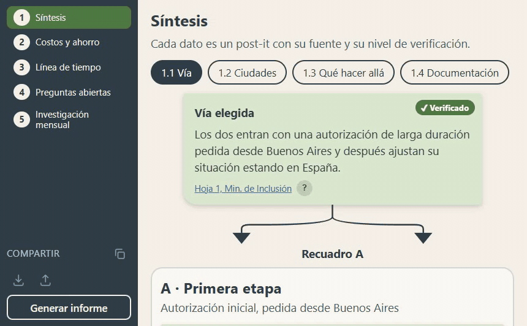
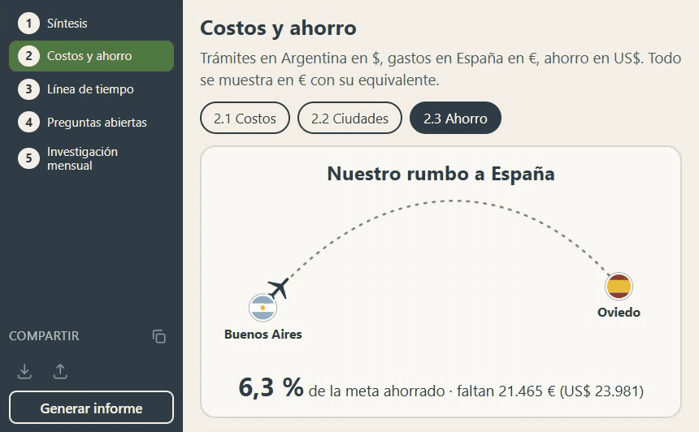
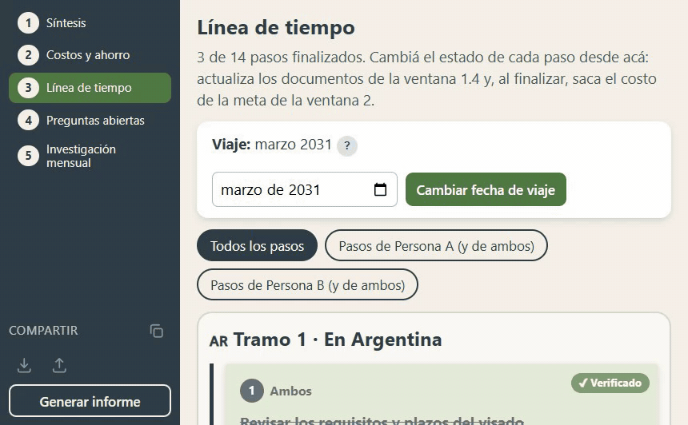
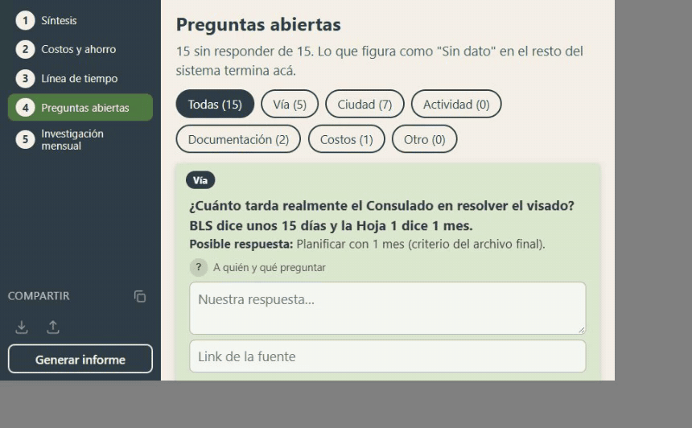
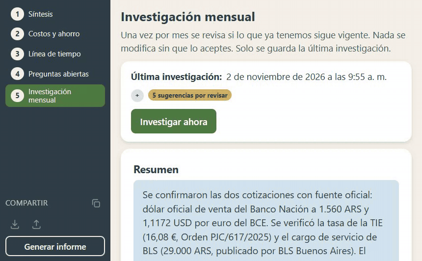

# Rumbo España

Sistema web local para organizar la información necesaria para vivir en España: trámites, costos, ahorro y preguntas sin responder, con una investigación mensual hecha por una IA. Es un proyecto personal e individual que arranqué en octubre de 2026.

## Problema que resuelve

Tenía seis informes sobre los trámites, las ciudades, la documentación y los costos. No siempre coincidían entre sí: un plazo figuraba en 60 días en uno y en 2 meses en otro, la tasa de un trámite variaba entre 160 € y 166,50 € según la fuente, y una página decía una cosa y la oficial la contraria. Con eso no se puede planificar ni ahorrar.

El desafío técnico tenía tres partes:

- Que cada dato diga de dónde sale y qué tan confiable es, para no mezclar un artículo del BOE con un blog.
- Que otra persona, que no programa, lo use desde su compu o su celular sin que el plan quede publicado en internet.
- Que la información se revise sola cada mes sin que la IA pueda cambiar nada por su cuenta.

## Demo

Los GIFs usan un juego de datos inventado: los requisitos, tasas y normativa son públicos, y los nombres, fechas, montos y estados de los trámites son ficticios.

**1. Síntesis:** la vía, las ciudades y la documentación, con un post-it por dato.

**2. Costos y ahorro:** costos fijos y por ciudad, meta en € y carga de aportes en US$.

**3. Línea de tiempo:** los pasos en Argentina y en España, filtrables por persona.

**4. Preguntas abiertas:** lo que todavía no sé, con a quién preguntar y dónde cargar la respuesta.

**5. Investigación mensual:** sugerencias de la IA para aceptar o rechazar.

## Tecnologías

- Node.js 24 y Express 4
- JavaScript, HTML y CSS sin framework ni paso de compilación (módulos ES en el navegador)
- Archivos JSON como almacenamiento
- adm-zip para las copias de seguridad
- Claude Code en modo no interactivo (`claude -p`) con el modelo Sonnet 5.5 para la investigación
- PowerShell para el acceso directo, el firewall y la tarea programada de Windows

## Cómo funciona

El servidor (`servidor/servidor.js`) expone una API para leer y guardar ocho archivos JSON y sirve la web de `web/`, con una ventana por pantalla. `investigacion/ejecutar.js` lanza la investigación mensual y `servidor/acceso.js` controla quién entra. Las decisiones vigentes del plan están en `PLAN.md`.

Las decisiones que tomé y por qué:

- **JSON en vez de base de datos.** Son pocos datos, lo usan dos personas y quería que se pudiera leer, copiar y respaldar a mano. Las escrituras van a un archivo temporal que después reemplaza al original, para que un corte no deje un JSON a medias. Antes de importar una copia, el sistema guarda una del estado actual.
- **Cada dato es un post-it con fuente y verificación.** Hay cuatro niveles: verificado (fuente oficial), verificado secundario (universidades, colegios profesionales), no verificado y sin dato. El nivel sale del tipo de sitio de la fuente. Si dos fuentes se contradicen, el sistema no elige: deja la pregunta abierta.
- **La IA solo busca y propone.** `claude -p` corre con permiso únicamente para WebSearch y WebFetch, sin leer ni escribir archivos. El script de Node recibe el resultado y es el único que escribe `datos/investigacion.json`. Cada sugerencia queda pendiente hasta que yo la acepto o la rechazo.
- **Las preguntas se reparten por turnos, no al azar.** Con muchas preguntas sin responder y pocas por corrida, el azar puede dejar algunas sin revisar durante meses. Van primero las que nunca se investigaron o hace más tiempo que no se miran, y el tema (vía, costos, documentación) solo desempata. Si la IA no encuentra respuesta, la pregunta descansa 90 días.
- **Red de casa en vez de hosting público.** El servidor escucha en toda la red, pero rechaza cualquier IP que no sea privada (rangos de la RFC 1918 y equivalentes de IPv6). Desde mi compu entro sin PIN. Desde otro dispositivo hace falta un PIN guardado con scrypt y sal, y una cookie de sesión `HttpOnly` y `SameSite=Strict`. Después de 5 intentos fallidos, esa IP queda bloqueada 10 minutos. Lanzar la investigación e importar copias solo se puede desde mi compu.
- **La meta de ahorro toma el mayor entre dos números.** Entre los medios que exige el visado y el costo real de 12 meses, se toma el más alto, con la opción de sumarlos. La cuota mensual se cuenta desde el mes siguiente hasta el mes anterior al viaje. Los trámites en Argentina van en $, el ahorro en US y la meta en €, con dos cotizaciones editables.
- **El estado de los documentos sale de la línea de tiempo.** Si todos los pasos vinculados a un documento tienen el mismo estado, el documento toma ese; si están mezclados, figura «En trámite». Un costo deja de contar en la meta cuando su paso está finalizado. Si cambio la fecha de viaje, se mueven solos los pasos pendientes y quedan fijos los que ya están en trámite.
- **El informe es un único HTML.** Se genera en el navegador con los mismos cálculos de la app, sin librerías ni internet, para mandarlo por mail o imprimirlo.

## Cómo correrlo

Es de uso personal y corre en mi compu directamente. Se abre con un acceso directo del escritorio.

## Qué aprendí y qué mejoraría

**Qué aprendí**

- A pensar el acceso desde la red local: leí la documentación de Node y la RFC 1918 para entender qué direcciones son privadas y cuáles no.
- A guardar un PIN con scrypt y sal en vez de en texto plano, y a limitar los intentos por IP.
- Que elegir al azar no garantiza que todo se revise. Con 5 preguntas por mes sobre unas 50, el sorteo puede dejar algunas afuera por meses. Lo resolví con un orden por antigüedad. La inanición de procesos la vi en una materia de la facultad y la idea de envejecimiento (aging) la aprendí buscando.
- A darle a una herramienta de IA solo los permisos que necesita y a dejar que un script propio sea el único que escribe los datos.

**Qué mejoraría**

- Que cambiar el PIN cierre las sesiones abiertas. Hoy una sesión dura 30 días aunque el PIN cambie.
- Agregar pruebas automáticas. Hoy no hay ninguna y pruebo todo a mano.
- Separar `servidor/servidor.js` en módulos (datos, copias, investigación). Hoy tiene todo junto.
- Poder editar los post-its desde la pantalla y deshacer una sugerencia aceptada.
- Sacar de la interfaz los nombres de las personas escritos a mano en el código, para que sirva a cualquier otro usuario.
- Cifrar el tráfico. Hoy es HTTP simple, razonable en una red de casa pero no fuera de ella.

